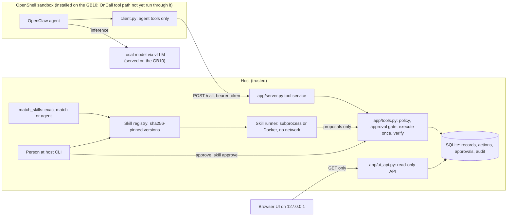

# SkillForge

**A local AI runtime that turns an independently verified, human-approved fix into an immutable skill, then reuses
that skill deterministically instead of making another model call.**

> **Status, read first.** Most of this repository was built and tested on a Windows 11 x86_64 dev box with no GPU,
> synthetic data, a scripted MOCK agent and recorded simulations; the committed demo recording is a
> `RECORDED_SIMULATION`. On 2026-10-25 the GB10 operator ran a live Qwen3.6-35B-A3B on the Dell Pro Max GB10: one
> live-written skill passed the hidden suite 9/9 (an identical repeat scored 8/9 and was rejected; the original prompt
> passed 0 of 3). **Then a person (the operator) approved that skill on the GB10 host CLI; INC-2 was reused with 0 model calls (6 trials, p50 28.2 ms) and INC-3 was refused.**
> The GB10 OnCall runs used the subprocess runner, not Docker, and none of them ran under NemoClaw/OpenShell. Numbers and
> sha256: [docs/BENCHMARKS.md](docs/BENCHMARKS.md#3-gb10-live-measurements-2026-10-25).
>
> **Stack status (GB10 operator report, 2026-10-25).** NemoClaw v0.0.137 (pinned), OpenShell 0.0.116 and OpenClaw v2026.9.2 are now installed on the GB10 (operator-authorized, no sudo), with sandbox `skillforge` pointing at the local Qwen. A **Telegram <-> local model round trip is verified** from OpenShell logs. **Gate 2 GO (13/13, GB10 operator report):** an OpenClaw agent inside the OpenShell sandbox called SkillForge host tools through the applied `host-tools` policy and got records back (records-ops tools only). **Not verified:** OpenClaw driving the OnCall synthesis/verification flow (Gates 3/4 in progress), Telegram -> SkillForge tools end to end in one message (the two halves are each verified; the joined chain is not recorded), a non-allowlisted-sender check, a full egress review. Nemotron attempt 6 failed. See [integrations/telegram/telegram_setup.md](integrations/telegram/telegram_setup.md), [integrations/telegram/GAPS.md](integrations/telegram/GAPS.md) and [docs/CLAIMS.md](docs/CLAIMS.md).
>
> **Hosted preview:** https://skillforge-ui-lab.vercel.app (Vercel project `skillforge-ui-lab`, Root Directory `ui`): read-only, recorded data, no backend calls.

## 1. What it is

SkillForge lets a local model solve an operations problem once, under human approval and independent verification,
and then handles the same class of problem again with a small, tested, hash-pinned program and no model at all.

## 2. Problem

Operations teams see the same incidents again and again. An LLM agent can investigate them, but each time it costs
GPU time, its answer can differ from last time, and it cannot be trusted to grade or approve its own fix. On a
single local machine such as a GB10, inference capacity is also the scarcest resource.

## 3. Solution and what is different

- **Learned fixes become executable skills.** After a solve is approved and verified, the model drafts a skill
  (`SKILL.md`, `scripts/helper.py`, tests). Trusted code lints it, runs its tests in an isolated runner, replays it
  against the approved fix and runs a hidden suite the model never sees.
- **A person promotes the skill on the host; the agent cannot.** The approved file tree is sha256-pinned and
  versioned; a changed file is refused.
- **Reuse is deterministic.** A trusted matcher selects a skill only on an exact match. The skill only proposes;
  its proposals pass the same policy, approval and verification gates. No model client is constructed.
- **Refusal is a result.** Lookalike data, stale contracts and changed incident fingerprints are refused with a
  typed reason.

The design point is the combination: independently verified, human-approved, immutable executable skills,
reused deterministically instead of another LLM call. This is a design claim; it has **not** been benchmarked against
other agent-memory approaches. The model step has run live on the GB10 (1 of 2 attempts with a disclosed prompt
revision passed the verifier; 0 of 3 with the original prompt). A person (the operator) then approved that skill on the
GB10 host CLI and it was reused on INC-2 with 0 model calls (see section 8).

## 4. How it works

| stage | what happens | who |
|---|---|---|
| solve | agent investigates, proposes a bounded fix; a person approves on the host; trusted code executes once and re-reads state to verify | model + person + code |
| synthesize | the model writes the skill | model (live on the GB10, see section 8; the committed demo is a recorded simulation) |
| validate | AST allowlist lint, own tests in the sandbox, replay must reproduce the approved fix, hidden suite | code |
| approve | `python -m app skill approve <name> <version> --by <person>`; hashes must match what was tested | person |
| reuse | exact-match routing, skill proposes, policy + approval + verification again | code + person |
| maintain | failed verification counted; `rollback`, `disable`; `UNIQUE(name, version)` | person |

Details: [docs/ARCHITECTURE.md](docs/ARCHITECTURE.md), [docs/SKILLFORGE.md](docs/SKILLFORGE.md).

## 5. Architecture



## 6. OnCall demonstration

Three synthetic incidents on an inference-serving stack (`experiments/oncall_infer/`):

- **INC-1**: a deploy raised `max_num_seqs` 128 → 1024; CUDA OOM; the gateway returns 429s.
- **INC-2**: same failure class, another service, another key (`max_model_len`).
- **INC-3**: a lookalike: disk full (`OSError`), no config regression.

A skill is synthesized for INC-1 (by the model with `--live`, otherwise a labelled hand-written reference skill),
validated (lint, own tests, INC-1 replay, capacity check, 9-case hidden suite) and stops for a person's approval.
After approval, INC-2 is handled by the skill with `model_calls: 0`, and INC-3 is refused by the incident
fingerprint. The committed run (`ui/public/demo/oncall-run.recorded.json`) is a `RECORDED_SIMULATION`: the skill was
written by a coding agent and the approval was typed by an agent (`approval.kind: simulated`). The guided demo at
`#/demo` shows six scenes with a mode banner that names the source of every screen. Walkthrough:
[docs/DEMO_GUIDE.md](docs/DEMO_GUIDE.md). For presenters: [pitch](docs/JUDGE_PITCH.md),
[live demo runbook](docs/LIVE_DEMO_RUNBOOK.md), [judge Q&A](docs/JUDGE_QA.md),
[GB10 evidence checklist](docs/GB10_EVIDENCE_CHECKLIST.md).

|  |  |
|---|---|
| Scene 5: INC-2 reuse with 0 model requests (from the committed recorded run, 256.0 ms on the dev box) and INC-3 refused | Scene 4: the banner and the panel say the skill code was hand-written |

## 7. Implemented vs supported features

Status values: **implemented + tested on dev box**, **recorded simulation**, **stub-tested**, **not verified on
hardware**.

| feature | status |
|---|---|
| Policy check, host-only approval, execute-once, re-reading verifier, audit | implemented + tested on dev box |
| Skill lint, sandboxed tests, replay, hidden suite, sha256 pinning, versions, rollback | implemented + tested on dev box |
| Deterministic exact-match reuse with zero model calls | implemented + tested on dev box (MOCK); recorded simulation (OnCall) |
| OnCall incident fingerprint, fail-closed, bound to the registry row | implemented + tested on dev box |
| Model writes the OnCall skill (`--live`) | run on the GB10: 1 of 2 passed with a disclosed prompt revision, 0 of 3 with the original ([BENCHMARKS.md](docs/BENCHMARKS.md#3-gb10-live-measurements-2026-10-25)) |
| Person (the operator) approves the live skill on the GB10 host CLI; INC-2 reuse with 0 model calls (6 trials, p50 28.2 ms); INC-3 refused | run on the GB10, subprocess runner, `--by` unverified ([BENCHMARKS.md](docs/BENCHMARKS.md#3-gb10-live-measurements-2026-10-25)) |
| Docker runner (`--network none --read-only --cap-drop ALL`) | implemented + tested on dev box (Docker Desktop); not run on the GB10 |
| Guided demo, console, Daylight World, Bootstrap Lite | implemented + tested on dev box (mock e2e 78/78, reported) |
| Demo launchers | implemented; verified on Windows only |
| GB10 bundle, preflight, compute-frontier harness | run on the GB10 (frontier: 70 requests, 0 errors) |
| NemoClaw v0.0.137 / OpenShell 0.0.116 / OpenClaw v2026.9.2 install, sandbox `skillforge`, Telegram <-> local model round trip | run on the GB10, verified from OpenShell OCSF logs (claim 26) |
| Gate 2: OpenClaw (in the OpenShell sandbox) -> SkillForge host tools round trip with records-ops tools (`search_skills`, `read_records`, `get_audit`); `host-tools` policy applied; `decide_approval` absent from the agent tool set | run on the GB10, 13/13, verified from tool-service and OCSF logs (claims 23, 26) |
| OnCall synthesis/verification driven by OpenClaw (Gates 3/4); Telegram -> SkillForge tools in one end-to-end message; non-allowlisted-sender check; full egress review | not run / not verified (Gates 3/4 in progress) |
| GPU, power and token measurements | measured for the frontier run and OnCall attempt 5 only; none for the passing attempt 4 (not captured) |
| Freight-accruals workflow (second domain, simulated channel) | implemented + tested on dev box |

All claims with their tests: [docs/CLAIMS.md](docs/CLAIMS.md).

## 8. GB10 hardware and local model integration

Intended: SkillForge's host service and console run on a Dell Pro Max with NVIDIA GB10; OpenClaw runs in a
NemoClaw/OpenShell sandbox; a local model (primary `Qwen3.6-35B-A3B` NVFP4, alternate NVIDIA Nemotron 3.5 Lightning,
`data/models.json`) is served by vLLM on `127.0.0.1:8000`. The intent is that nothing leaves the box; the SkillForge `host-tools` egress policy was applied and exercised on the GB10 for the Gate 2 records-ops round trip only (no
OnCall flow, no negative test recorded) ([docs/SECURITY.md](docs/SECURITY.md#network-exposure)).

**Measured on the GB10 (2026-10-25, GB10 operator's report; evidence files on the GB10/SSD, sha256 in
[docs/BENCHMARKS.md](docs/BENCHMARKS.md#3-gb10-live-measurements-2026-10-25)):** NVIDIA GB10, aarch64, driver
580.178.04, 121.63 GiB, vLLM 0.21.0+2325b6f0.dev serving Qwen3.6-35B-A3B-NVFP4 as `skillforge-qwen`
(earlier config: `max_model_len` 32768, gpu-memory-utilization 0.4, max-num-seqs 4). Per-request streaming, 0 of 70 requests failed: TTFT p50 0.0623 s at c=1, 0.1087 s at c=2,
0.1026 s at c=4; decode p50 75.63 / 61.83 / 55.27 tok/s per request (not aggregate throughput). Live OnCall
synthesis: attempt 4 (revised prompt) one model call, 173.0 s, 12,763 completion tokens, hidden 9/9, regression 5/5,
staged as `tested`, proposal only; attempt 5 (same config) hidden 8/9, rejected. **Not true on the GB10:** the OnCall runs did not
run under NemoClaw/OpenShell; Docker was permission-denied, so every run used the subprocess runner.
**Serving change and Qwen-only bench (GB10, UNCONTENDED; Nemotron stopped on purpose after 0/2 on OnCall, container kept):** Qwen3.6-35B-A3B-NVFP4, vLLM 0.21.0, gpu-memory-utilization 0.80, `max_model_len` 131072, max-num-seqs 16, fp8 KV. KV cache 6,669,475 tokens (was 183k); vLLM reports 50.88x concurrency at 128k; memory about 88% used (106.8/121.6 GiB). `frontier.sh`, thinking off, c=1/2/4: TTFT p50 0.058 / 0.085 / 0.082 s, decode 73.8 / 59.2 / 55.6 tok/s per request, aggregate 73.8 / 118.4 / 222.5 tok/s, 0 of 70 errors. Single-stream decode is unchanged (memory-bandwidth bound); the change buys context (32k -> 128k), KV capacity and concurrency headroom, not speed. **All OnCall results on this page (attempts 1-6, approval, reuse) were measured under the earlier config (0.4 / 32k / 4 seqs).** Default `ONCALL_MAX_TOKENS` is now 24000 (`d14701d`): live thinking runs used 12-17k tokens and 8192 truncated them. Full tables and both configs: [docs/BENCHMARKS.md](docs/BENCHMARKS.md#3-gb10-live-measurements-2026-10-25).
**Approval and reuse (GB10, 2026-10-25, earlier config):** at 20:25:02Z a person (the operator) ran `skill approve` on the host CLI (status approved, tree sha256 matches, hidden suite re-run ok; the `--by` name is not identity-verified). INC-2 reuse: 0 model calls, 27.0 ms (6 fresh-process trials: p50 28.2, min 27.0, max 42.1 ms); vLLM request counters unchanged. INC-3 refused by the incident fingerprint every time. Latency is the reuse decision plus the sandboxed run in the subprocess runner, not a speed-up claim against synthesis. Procedure: [docs/GB10_SETUP.md](docs/GB10_SETUP.md)
and [docs/GB10_RUNBOOK.md](docs/GB10_RUNBOOK.md) (gates 0–5).

**Stack on the GB10 (2026-10-25, operator report):** NemoClaw v0.0.137 (pinned), OpenShell 0.0.116, OpenClaw v2026.9.2; sandbox `skillforge` (agent openclaw, restricted tier), inference provider compatible-endpoint to `skillforge-qwen` at `127.0.0.1:8000`, reached inside the sandbox as `https://inference.local`; sandbox GPU/CUDA verified; the only network policy is `telegram_bot` (`api.telegram.org:443`, rest, enforce). **Verified: Telegram <-> local model round trip** (OCSF: getUpdates -> inference.local -> sendChatAction -> sendMessage, all ALLOWED by `telegram_bot`; `skillforge-qwen` logged 5 chat completions in the window, Nemotron 0; OpenClaw's own telemetry to `telemetry.openclaw.ai:443` was DENIED). Evidence on the GB10: `openshell-ocsf.txt` sha256 `2237e29930c8846da986b97163df10662165ea4c1c812277b76c0c40bec290e7` (token-free; not in this repo). **Gate 2 GO (13/13):** OpenClaw in sandbox `skillforge` called SkillForge host tools (`search_skills`, `read_records`, `get_audit`) through policy `host-tools` (only `host.openshell.internal:8765`, rest/enforce, POST `/call`, binary `/usr/bin/python3`); see [docs/CLAIMS.md](docs/CLAIMS.md) #23 and #26. **Not verified:** OpenClaw driving the OnCall flow (Gates 3/4 in progress), Telegram -> SkillForge tools in one end-to-end message, a non-allowlisted-sender check, a full egress review. The OnCall loop has not run under this stack. Setup and gaps: [integrations/telegram/telegram_setup.md](integrations/telegram/telegram_setup.md), [integrations/telegram/GAPS.md](integrations/telegram/GAPS.md).

**Nemotron attempt 6 failed** (adapter fix applied): both calls hit `max_tokens`=32000 while reasoning (finish_reason=length), so no candidate came back; Nemotron is 0 of 2, Qwen 1 pass in 4. See [BENCHMARKS.md](docs/BENCHMARKS.md#3-gb10-live-measurements-2026-10-25).

**Known conflict:** NemoClaw's auth proxy listens on `0.0.0.0:11435` (token-protected, hard-coded upstream, not configurable). This project's no-0.0.0.0 rule covers SkillForge's own services, so this is a disclosed exception, not a pass. Proposed mitigation (UFW: allow loopback and 172.18.0.0/16 to 11435, deny the rest) is **not applied**; pending operator decision ([SECURITY.md](docs/SECURITY.md#network-exposure)).

## 9. Reproduce the demo

Requirements: Python ≥ 3.11 (stdlib only at runtime); Node.js to build the UI. If `ui/node_modules` is absent, the
launcher runs `npm --prefix ui ci` (network).

```bash
./start-demo.ps1 --no-open            # Windows PowerShell
bash start-demo.sh --no-open          # Linux, macOS, Git Bash (verified on Windows only)
```

Open the one-time login link the launcher prints, then:

- `http://127.0.0.1:8766/#/demo`: guided six-scene OnCall demo
- `http://127.0.0.1:8766/#/console/investigations/incident`: console incident view
- `http://127.0.0.1:8766/#/console/overview`, `#/world`, `#/world/onboard`: console, Daylight World, Bootstrap Lite

Options: `--port 8766` (default), `--no-open`, `--reset-demo` (deletes only `data/unified/`). OnCall from the command
line: `python -m experiments.oncall_infer run` (recorded reference skill), the printed `skill approve` command typed
by a person, then `python -m experiments.oncall_infer reuse`.

## 10. Tests and measured performance

```bash
pip install pytest
python -m pytest -q -p no:cacheprovider tests/test_contracts.py experiments/oncall_infer/test_oncall_infer.py experiments/gb10_bench
python -m pytest -q -p no:cacheprovider        # full suite, about 3 min
```

Results on the dev box (Windows 11 x86_64, Python 3.14.3, no GPU) are in
[docs/DEVELOPMENT_LOG.md](docs/DEVELOPMENT_LOG.md#part-3-tests-on-this-tree). Dev-box measurements:

- OnCall INC-2 reuse: `model_calls: 0`; about 117–256 ms across recorded runs. This is match plus deterministic
  execution, **not** an inference saving.
- MOCK benchmark: tool calls 20 → 7–8 with reuse; latency 0.06 s → 0.17 s (worse in mock).
- Indexed freight variant: 31× faster skill compute at 4,400 records; human-authored research, not promoted.

GB10 measurements (section 8) are separate: [docs/BENCHMARKS.md](docs/BENCHMARKS.md) keeps the three kinds of numbers
apart. GB10 reuse latency: 6 trials, p50 28.2 ms (subprocess runner; match plus deterministic skill run; 0 model calls).

## 11. What was built when

**Pre-event foundation (before 2026-10-25, developed 2026-10-20 to 2026-10-23):** the core runtime (`app/`,
`adapters/`: SQLite store, tool service, approval and verification gates, skill registry), the pinned verifiers, the
three-mode benchmark, the freight workflow, the router and catalog experiments, the console, Daylight World and
Bootstrap Lite UI, and the GB10 runbooks. This is **not** hackathon-day work.

**Event-day work (2026-10-25):**

- demo launchers
- OnCall loop and recorded artifact
- guided six-scene demo, console incident view
- fingerprint and approval-kind fixes after a bypass audit
- GB10 compute-frontier harness (later run on the GB10)
- real-backend browser rehearsal fixes
- GB10 handoff: strict `--live`, served-id discovery, portable bundle, preflight
- GB10 live runs: frontier throughput, five live OnCall synthesis attempts, a lint-bypass fix
- release preparation (this tree)

Commit hashes, dates, status and the tests actually run: [docs/DEVELOPMENT_LOG.md](docs/DEVELOPMENT_LOG.md).

## 12. Security and approvals

Approvals are host CLI commands only; the agent has no approve tool and the UI is read-only. `approval.kind` is
`simulated` or `host_cli`, and the `--by` name is **not** identity-verified. Skills are sha256-pinned and versioned.
Generated code runs in a subprocess runner (a Python-level socket block, **not** an isolation boundary) or, with
`SKILL_RUNNER=docker`, in a Docker runner with `--network none`; Docker isolation was checked on the dev box only
(GB10 runs used the subprocess runner, so hidden-suite secrecy against a hostile skill is not guaranteed there; the lint
is not a boundary, and a bypass found by a GB10-side audit was fixed). Services refuse `0.0.0.0`. The OnCall fingerprint
fails closed; the core matcher's INC-3 false-exact gap is documented and contained. Details and vulnerability
reporting: [docs/SECURITY.md](docs/SECURITY.md).

## 13. Limitations

Live synthesis is 1 pass in 2 revised-prompt attempts (0 of 3 before); approval and reuse on the GB10 done (6 reuse trials; `--by` name unverified); GB10
runs used the subprocess runner and no NemoClaw; core matcher gap; 15 s sandbox timeout risk under load; flaky
tests seen under load; approver identity not verified; launchers verified on Windows only. Full list:
[docs/LIMITATIONS.md](docs/LIMITATIONS.md).

## 14. Team and acknowledgments

**Team:** members are not recorded in git; the commits carry a team identity only.

**Acknowledgments:** Dell Technologies (Pro Max GB10) and NVIDIA (GB10, NemoClaw, OpenShell, Nemotron); the vLLM
project; OpenClaw; the Qwen team at Alibaba Cloud and NVIDIA as model publishers; and the open-source projects the UI
is built on (React, Vite, Motion, Lucide, Playwright, axe-core, Fontsource with the JetBrains Mono and Schibsted
Grotesk fonts under the SIL Open Font License 1.1). See [LICENSE](LICENSE) for third-party licences.

**AI assistance:** Claude Code was used to write code and documentation. Commits carry a `Co-Authored-By: Claude`
trailer.

## Licence

MIT. Copyright (c) 2026 the SkillForge team; see [LICENSE](LICENSE).
Third-party dependencies remain under their own licences.
