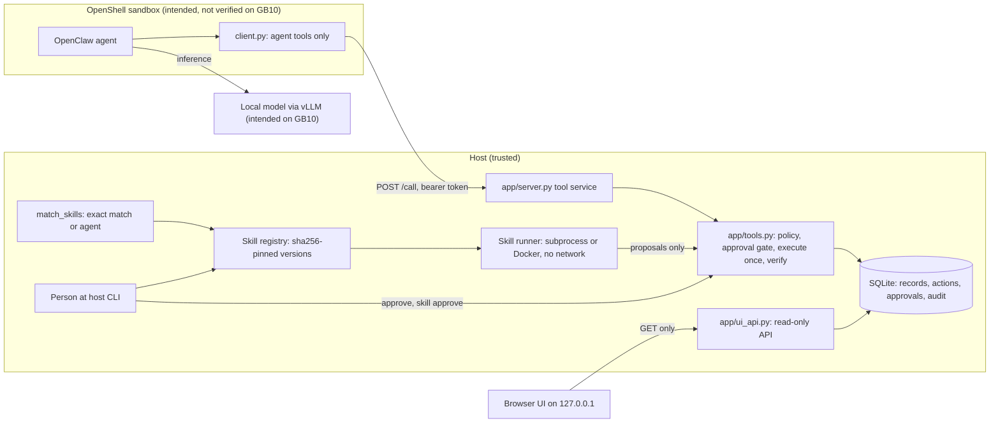
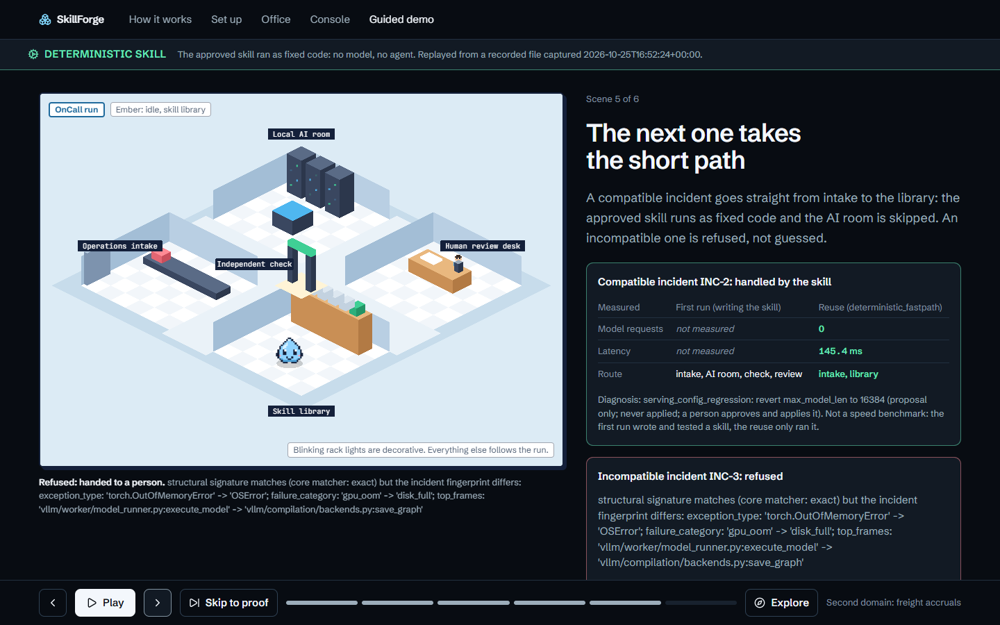
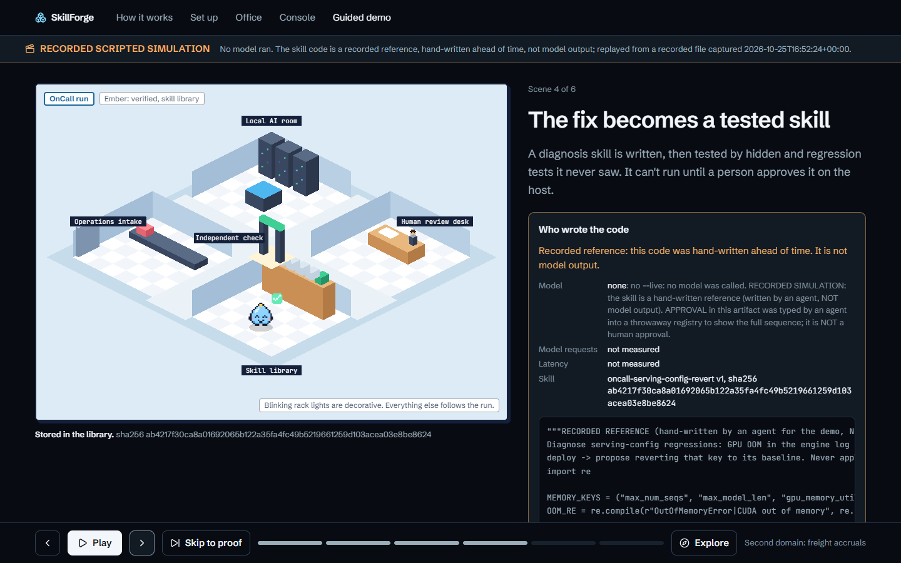

# SkillForge

**A local AI runtime that turns an independently verified, human-approved fix into an immutable skill, then reuses
that skill deterministically instead of making another model call.**

> **Status, read first.** Everything here has run only on a Windows 11 x86_64 dev box with no GPU,
> synthetic data, a scripted MOCK agent and recorded simulations. **No real model has produced any result in this
> repository, and nothing has been measured on the Dell Pro Max GB10 yet.**

## 1. What it is

SkillForge lets a local model solve an operations problem once, under human approval and independent verification,
and then handles the same class of problem again with a small, tested, hash-pinned program and no model at all.

## 2. Problem

Operations teams see the same incidents again and again. An LLM agent can investigate them, but each time it costs
GPU time, its answer can differ from last time, and it cannot be trusted to grade or approve its own fix. On a
single local machine such as a GB10, inference capacity is also the scarcest resource.

## 3. Solution and what is different

- **Learned fixes become executable skills.** After a solve is approved and verified, the model drafts a skill
  (`SKILL.md`, `scripts/helper.py`, tests). Trusted code lints it, runs its tests in an isolated runner, replays it
  against the approved fix and runs a hidden suite the model never sees.
- **A person promotes the skill on the host; the agent cannot.** The approved file tree is sha256-pinned and
  versioned; a changed file is refused.
- **Reuse is deterministic.** A trusted matcher selects a skill only on an exact match. The skill only proposes;
  its proposals pass the same policy, approval and verification gates. No model client is constructed.
- **Refusal is a result.** Lookalike data, stale contracts and changed incident fingerprints are refused with a
  typed reason.

The design point is the combination: independently verified, human-approved, immutable executable skills,
reused deterministically instead of another LLM call. This is a design claim; it has **not** been benchmarked against
other agent-memory approaches. There is **no** live autonomous skill-generation loop yet: the model step has run only
as a recorded simulation.

## 4. How it works

| stage | what happens | who |
|---|---|---|
| solve | agent investigates, proposes a bounded fix; a person approves on the host; trusted code executes once and re-reads state to verify | model + person + code |
| synthesize | the model writes the skill | model (recorded simulation so far) |
| validate | AST allowlist lint, own tests in the sandbox, replay must reproduce the approved fix, hidden suite | code |
| approve | `python -m app skill approve <name> <version> --by <person>`; hashes must match what was tested | person |
| reuse | exact-match routing, skill proposes, policy + approval + verification again | code + person |
| maintain | failed verification counted; `rollback`, `disable`; `UNIQUE(name, version)` | person |

Details: [docs/ARCHITECTURE.md](docs/ARCHITECTURE.md), [docs/SKILLFORGE.md](docs/SKILLFORGE.md).

## 5. Architecture



## 6. OnCall demonstration

Three synthetic incidents on an inference-serving stack (`experiments/oncall_infer/`):

- **INC-1**: a deploy raised `max_num_seqs` 128 → 1024; CUDA OOM; the gateway returns 429s.
- **INC-2**: same failure class, another service, another key (`max_model_len`).
- **INC-3**: a lookalike: disk full (`OSError`), no config regression.

A skill is synthesized for INC-1 (by the model with `--live`, otherwise a labelled hand-written reference skill),
validated (lint, own tests, INC-1 replay, capacity check, 9-case hidden suite) and stops for a person's approval.
After approval, INC-2 is handled by the skill with `model_calls: 0`, and INC-3 is refused by the incident
fingerprint. The committed run (`ui/public/demo/oncall-run.recorded.json`) is a `RECORDED_SIMULATION`: the skill was
written by a coding agent and the approval was typed by an agent (`approval.kind: simulated`). The guided demo at
`#/demo` shows six scenes with a mode banner that names the source of every screen. Walkthrough:
[docs/DEMO_GUIDE.md](docs/DEMO_GUIDE.md). For presenters: [pitch](docs/JUDGE_PITCH.md),
[live demo runbook](docs/LIVE_DEMO_RUNBOOK.md), [judge Q&A](docs/JUDGE_QA.md),
[GB10 evidence checklist](docs/GB10_EVIDENCE_CHECKLIST.md).

|  |  |
|---|---|
| Scene 5: INC-2 reuse with 0 model requests (from the committed recorded run, 256.0 ms on the dev box) and INC-3 refused | Scene 4: the banner and the panel say the skill code was hand-written |

## 7. Implemented vs supported features

Status values: **implemented + tested on dev box**, **recorded simulation**, **stub-tested**, **not verified on
hardware**.

| feature | status |
|---|---|
| Policy check, host-only approval, execute-once, re-reading verifier, audit | implemented + tested on dev box |
| Skill lint, sandboxed tests, replay, hidden suite, sha256 pinning, versions, rollback | implemented + tested on dev box |
| Deterministic exact-match reuse with zero model calls | implemented + tested on dev box (MOCK); recorded simulation (OnCall) |
| OnCall incident fingerprint, fail-closed, bound to the registry row | implemented + tested on dev box |
| Model writes the OnCall skill (`--live`) | stub-tested; not verified on hardware |
| Docker runner (`--network none --read-only --cap-drop ALL`) | implemented + tested on dev box (Docker Desktop) |
| Guided demo, console, Daylight World, Bootstrap Lite | implemented + tested on dev box (mock e2e 78/78, reported) |
| Demo launchers | implemented; verified on Windows only |
| GB10 bundle, preflight, compute-frontier harness | stub-tested; not verified on hardware |
| NemoClaw / OpenShell sandbox and egress policy | not verified on hardware |
| GPU, power and token measurements | not verified on hardware (none taken) |
| Freight-accruals workflow (second domain, simulated channel) | implemented + tested on dev box |

All claims with their tests: [docs/CLAIMS.md](docs/CLAIMS.md).

## 8. GB10 hardware and local model integration

Intended: SkillForge's host service and console run on a Dell Pro Max with NVIDIA GB10; OpenClaw runs in a
NemoClaw/OpenShell sandbox; a local model (primary `Qwen3.6-35B-A3B` NVFP4, alternate NVIDIA Nemotron 3.5 Lightning,
`data/models.json`) is served by vLLM on `127.0.0.1:8000`. The intent is that nothing leaves the box; the sandbox egress policy has not been
verified on a real runtime ([docs/SECURITY.md](docs/SECURITY.md#network-exposure)).

Confirmed so far, as reported by the operator: an aarch64 GB10 host with the GPU detected, about 121 GiB memory,
Docker 29.6.2. **Live Qwen inference is not confirmed**; `bash deploy/gb10/sf-gb10.sh preflight` has not passed on the
GB10. Procedure: [docs/GB10_SETUP.md](docs/GB10_SETUP.md) (bundle, transfer, preflight, live OnCall, rollback) and
[docs/GB10_RUNBOOK.md](docs/GB10_RUNBOOK.md) (gates 0–5).

## 9. Reproduce the demo

Requirements: Python ≥ 3.11 (stdlib only at runtime); Node.js to build the UI. If `ui/node_modules` is absent, the
launcher runs `npm --prefix ui ci` (network).

```bash
./start-demo.ps1 --no-open            # Windows PowerShell
bash start-demo.sh --no-open          # Linux, macOS, Git Bash (verified on Windows only)
```

Open the one-time login link the launcher prints, then:

- `http://127.0.0.1:8766/#/demo`: guided six-scene OnCall demo
- `http://127.0.0.1:8766/#/console/investigations/incident`: console incident view
- `http://127.0.0.1:8766/#/console/overview`, `#/world`, `#/world/onboard`: console, Daylight World, Bootstrap Lite

Options: `--port 8766` (default), `--no-open`, `--reset-demo` (deletes only `data/unified/`). OnCall from the command
line: `python -m experiments.oncall_infer run` (recorded reference skill), the printed `skill approve` command typed
by a person, then `python -m experiments.oncall_infer reuse`.

## 10. Tests and measured performance

```bash
pip install pytest
python -m pytest -q -p no:cacheprovider tests/test_contracts.py experiments/oncall_infer/test_oncall_infer.py experiments/gb10_bench
python -m pytest -q -p no:cacheprovider        # full suite, about 3 min
```

Results on the dev box (Windows 11 x86_64, Python 3.14.3, no GPU) are in
[docs/DEVELOPMENT_LOG.md](docs/DEVELOPMENT_LOG.md#part-3-tests-on-this-tree). Measurements, all from the dev box:

- OnCall INC-2 reuse: `model_calls: 0`; about 117–256 ms across recorded runs. This is match plus deterministic
  execution, **not** an inference saving.
- MOCK benchmark: tool calls 20 → 7–8 with reuse; latency 0.06 s → 0.17 s (worse in mock).
- Indexed freight variant: 31× faster skill compute at 4,400 records; human-authored research, not promoted.

**GB10 measurements: none yet.** Methodology and separation of the three kinds of numbers:
[docs/BENCHMARKS.md](docs/BENCHMARKS.md).

## 11. What was built when

**Pre-event foundation (before 2026-10-25, developed 2026-10-20 to 2026-10-23):** the core runtime (`app/`,
`adapters/`: SQLite store, tool service, approval and verification gates, skill registry), the pinned verifiers, the
three-mode benchmark, the freight workflow, the router and catalog experiments, the console, Daylight World and
Bootstrap Lite UI, and the GB10 runbooks. This is **not** hackathon-day work.

**Event-day work (2026-10-25):**

- demo launchers
- OnCall loop and recorded artifact
- guided six-scene demo, console incident view
- fingerprint and approval-kind fixes after a bypass audit
- GB10 compute-frontier harness (stub-tested)
- real-backend browser rehearsal fixes
- GB10 handoff: strict `--live`, served-id discovery, portable bundle, preflight
- release preparation (this tree)

Commit hashes, dates, status and the tests actually run: [docs/DEVELOPMENT_LOG.md](docs/DEVELOPMENT_LOG.md).

## 12. Security and approvals

Approvals are host CLI commands only; the agent has no approve tool and the UI is read-only. `approval.kind` is
`simulated` or `host_cli`, and the `--by` name is **not** identity-verified. Skills are sha256-pinned and versioned.
Generated code runs in a subprocess runner (a Python-level socket block, **not** an isolation boundary) or, with
`SKILL_RUNNER=docker`, in a Docker runner with `--network none`; Docker isolation was checked on the dev box only. Services refuse `0.0.0.0`. The OnCall fingerprint
fails closed; the core matcher's INC-3 false-exact gap is documented and contained. Details and vulnerability
reporting: [docs/SECURITY.md](docs/SECURITY.md).

## 13. Limitations

No real-model run yet; nothing measured on a GB10; core matcher gap; 15 s sandbox timeout risk under load; flaky
tests seen under load; approver identity not verified; launchers verified on Windows only. Full list:
[docs/LIMITATIONS.md](docs/LIMITATIONS.md).

## 14. Team and acknowledgments

**Team:** members are not recorded in git; the commits carry a team identity only.

**Acknowledgments:** Dell Technologies (Pro Max GB10) and NVIDIA (GB10, NemoClaw, OpenShell, Nemotron); the vLLM
project; OpenClaw; the Qwen team at Alibaba Cloud and NVIDIA as model publishers; and the open-source projects the UI
is built on (React, Vite, Motion, Lucide, Playwright, axe-core, Fontsource with the JetBrains Mono and Schibsted
Grotesk fonts under the SIL Open Font License 1.1). See [LICENSE](LICENSE) for third-party licences.

**AI assistance:** Claude Code was used to write code and documentation. Commits carry a `Co-Authored-By: Claude`
trailer.

## Licence

MIT. Copyright (c) 2026 the SkillForge team; see [LICENSE](LICENSE).
Third-party dependencies remain under their own licences.
