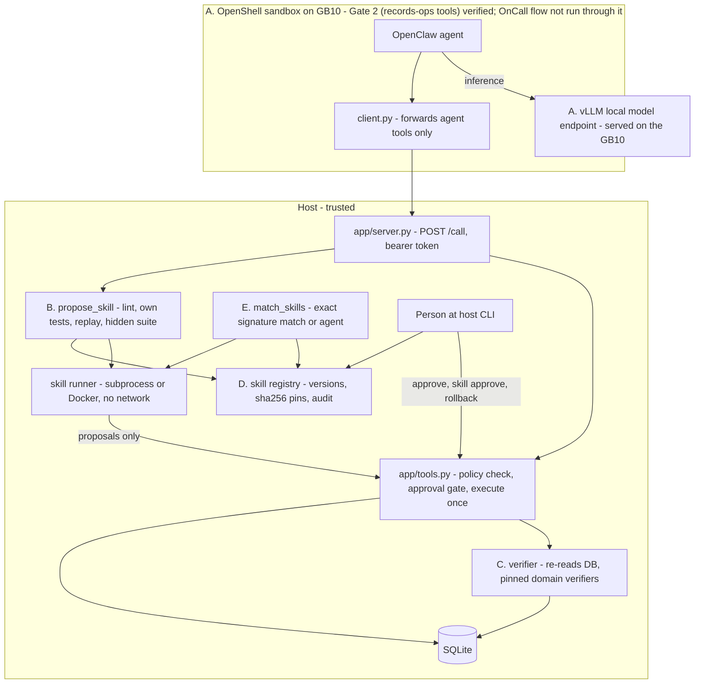

# Architecture and security

Scope: what the code in this repository does and where each part was checked. Everything marked "verified" was
verified on a Windows 11 x86_64 dev box without a GPU, with synthetic data and a MOCK agent, unless stated as GB10.
On the GB10 (2026-10-25) the following ran: vLLM serving, live OnCall synthesis and verification, approval and reuse
(subprocess runner), the NemoClaw/OpenShell/OpenClaw install, and the Gate 2 records-ops round trip through the sandbox.
The OnCall flow under OpenClaw (Gates 3/4) is in progress and is not verified. Security model and known gaps:
[SECURITY.md](SECURITY.md).

## A. Local inference: GB10, NemoClaw, OpenShell, vLLM

| piece | design | state |
|---|---|---|
| Model serving | vLLM with an OpenAI-compatible API on the GB10; primary `nvidia/Qwen3.6-35B-A3B-NVFP4`, alternate Nemotron 3.5 Lightning (`data/models.json`) | run on the GB10 (2026-10-25): vLLM 0.21.0 serving Qwen3.6-35B-A3B-NVFP4 as `skillforge-qwen`; Nemotron attempted, 0 of 2 on OnCall ([BENCHMARKS.md](BENCHMARKS.md#3-gb10-live-measurements-2026-10-25)). The committed recording contains no model output |
| Agent | OpenClaw inside a NemoClaw/OpenShell sandbox; SkillForge does not implement its own agent loop | installed on the GB10; Gate 2 (records-ops tools) GO 13/13; driving the OnCall flow (Gates 3/4) is in progress |
| Boundary | the sandbox holds only `SKILL.md`, `client.py`, `client.json`; the DB, verifier, hidden suite and approvals live on the host behind `python -m app serve` | service and client tested locally ([SKILLFORGE.md §11](SKILLFORGE.md#11-trust-boundary-v2-trusted-service-outside-the-sandbox)) |
| Egress policy | preset `adapters/openclaw/presets/host-tools.yaml`: host `host.openshell.internal`, POST `/call` only | applied and exercised on the GB10 for the Gate 2 records-ops round trip (no negative test recorded) |
| Model client | `adapters/llm.py`; `LLM_BASE_URL` unset or `mock` selects the MOCK client | MOCK when unset; the live OnCall runs used `--live` against the vLLM endpoint |
| Capability gate and failover | a model must pass a probe (endpoint, identity, tool call, schema, multi-step, latency) before it may write skills ([RESILIENCE.md](RESILIENCE.md)) | tested with mock and stubs |

Runbook: [GB10_RUNBOOK.md](GB10_RUNBOOK.md); setup notes: [GB10_SETUP.md](GB10_SETUP.md);
offline staging: [DEPLOY_MANIFEST.md](DEPLOY_MANIFEST.md).

## B. Program synthesis

A skill is a directory with `SKILL.md`, `scripts/helper.py` and `tests/test_helper.py`. The model writes
it after a verified solve. `propose_skill` (`app/skillforge.py`) then:

1. copies the draft to `candidates/<name>/vN` (over the service, it accepts file contents only, never a host path);
2. runs `lint`: an AST import and call allowlist (an early filter, not a proof);
3. runs the skill's own tests in the isolated runner;
4. replays the helper on the task's starting snapshot; its proposals must exactly equal the fixes a person approved
   and the verifier passed;
5. leaves the candidate `tested` or `failed_tests`. `hidden_check` later runs the hidden suite on the host.

In all recorded runs the author was a scripted MOCK flow, a human-written fixture
(`tests/fixtures/mock_authored_skill/`) or, for OnCall, a hand-written reference skill
(`experiments/oncall_infer/reference_skill/`). `experiments/oncall_infer` has a `--live` path that sends the prompt to
an OpenAI-compatible endpoint and counts calls; it fails loudly (exit 2, no run or registry written; audit in `<out stem>.failed.json`) instead of falling back, unless `--allow-fallback` is given. It is tested only against a stub server
(`test_live_path_counts_calls_and_tokens_against_a_stub_server`).

## C. Independent verification

| rule | where | test |
|---|---|---|
| Actions must match the policy: allowed action type, allowed field, value type and range, maximum change size | `_validate`, at propose time and again at execute time | `test_invalid_inputs_return_structured_errors` |
| Execution requires `status='approved'`, which only a human decision can set | `execute_action`, `decide_approval` | `test_execute_refused_without_approval`, `test_rejected_action_never_executes` |
| The agent tool set has no approve tool; approvers named `agent`, `system` or `policy` are rejected | `AGENT_TOOLS` | `test_agent_cannot_approve` |
| Proposals are deduplicated; each action executes once (`UNIQUE(action_id)`) | `propose_action`, `executions` | `test_duplicate_proposal_and_execution_prevented` |
| The verifier re-reads the database and re-runs the evidence comparison | `verify_action` | `test_verification_checks_real_state` |
| Domain verifiers are pinned and refuse contexts they were not validated for | `verifiers/pins.json`, `app/tools.py` | `test_tampered_or_unpinned_verifier_is_refused`, `test_newer_contract_revision_invalidates_the_verifier` (`tests/test_freight.py`) |
| A hidden suite the agent never sees must pass before promotion | `hidden_check` | `test_hidden_suite_catches_what_self_tests_and_replay_miss` |

**Tests are not a formal proof.** The replay, the skill's own tests and the hidden suite check finite cases. A
skill can pass all of them and still be wrong on inputs nobody wrote down. The run-time verifier is the second
line: every proposal a skill makes is verified after execution, and a failure is counted and returned as a hint.

## D. Secure promotion

- **Host-only approvals.** `approve`, `skill approve`, `skill reject`, `skill disable` and `skill rollback` are host
  CLI commands that take `--by <person>`. They are not agent tools; over the service they return `unknown_tool`.
  The browser UI is read-only (`app/ui_api.py`: loopback, Host check, one-time login, GET only).
- **Hashes.** A sha256 of the skill's file tree is taken at test time, checked at approval (`integrity_error` if the
  candidate changed) and checked on every run.
- **Versions.** `UNIQUE(name, version)`, one active version, rollback and disable.
- **Audit.** Every state change writes an audit row naming the actor.
- **No self-granted permissions.** The system writes `meta.json` with `allowed_operations: ["compute_proposals"]`;
  fields the agent supplies are ignored. A promoted skill only proposes.
- **Isolation.** `SKILL_RUNNER=docker`: `--network none --read-only --cap-drop ALL --security-opt no-new-privileges`,
  user 65534, 512 MB memory and swap, 1 CPU, 64 pids, the skill copy mounted read-only, killed on timeout. Checked
  locally on the dev box. The subprocess runner uses `python -I -B`, a scrubbed environment and a timeout; its
  rlimits are not applied on Windows.

Known gap: with the `--local` fallback package, the DB and tools run inside the sandbox and the agent has `exec`,
so the guarantees above hold only for paths through the tool interface ([SKILLFORGE.md §11](SKILLFORGE.md#11-trust-boundary-v2-trusted-service-outside-the-sandbox)).

## E. Deterministic reuse

- **Matcher.** `match_skills` compares a signature computed by trusted code (shape, kinds, sources, writable fields,
  invariants, plus the fields the skill touches). Exactly one approved, active skill must match exactly; otherwise
  the decision is `agent` with a reason. `run_skill` repeats the check (`uncertain_match`)
  ([SKILLFORGE.md §12](SKILLFORGE.md#12-deterministic-skill-matcher)).
- **Stale-contract invalidation** (experiment, `experiments/catalog/catalog.py`). When a pinned environment version
  changes (for example carrier contract `rev-2026-11`), dependent skills are marked `stale`, the registry entry is
  disabled so `run_skill` refuses it, and the same data is routed to a person until the skill is revalidated
  (`experiments/catalog/test_catalog.py`).
- **OnCall fingerprint refusal** (experiment, `experiments/oncall_infer/oncall.py`). For INC-3 the **core structural
  matcher says "exact"**, because the incident JSON has the same shape. The refusal comes from the experiment's
  incident fingerprint (exception type, component, failure category, top frames), which differs from the learned
  one. The fingerprint is bound to the approved skill's registry row (`skills.validation.incident_fingerprint`), and a
  missing fingerprint refuses (fail closed). Covered by `test_after_approval_inc2_reused_with_zero_model_calls_and_inc3_refused`.
  **Known core gap:** core reuse paths (`app/ops.py`, `app/skillforge.py`, `app/bench.py`, `experiments/router`) do
  not consult the fingerprint. A direct core `run_skill` on INC-3 is contained only because approval re-runs the
  hidden suite, whose lookalike cases force any approvable skill to propose nothing
  (`test_core_path_bypass_yields_no_proposal`). Closing the gap needs a core change; none was made.
- **No model on the reuse path.** OnCall reuse runs with a `NoModel` guard that counts any attempt and raises.

## F. Resource optimization

| item | state | evidence |
|---|---|---|
| Skip the model when an approved skill matches exactly | implemented | `app/bench.py` mode C; [SKILLFORGE.md §13](SKILLFORGE.md#13-three-mode-benchmark-python--m-app-bench) (MOCK) |
| Count model calls and tokens; unknown stays null | implemented | `adapters/metrics.py`, `bench`; OnCall `model_calls` |
| Learning break-even | implemented as a formula; the model-call input is not yet computed (no measured per-task model-call comparison) | [SKILLFORGE.md §14](SKILLFORGE.md#14-learning-break-even-benchbreakeven) |
| Faster skill variants | research only; the indexed freight variant is human-authored and was not promoted | [EXEC_PERF.md](EXEC_PERF.md) |
| TTFT probe for GB10 | run on the GB10 (frontier harness, 70 requests) | `experiments/gb10_bench/`, [GB10_BENCH_RUNBOOK.md](GB10_BENCH_RUNBOOK.md) |
| GPU-aware scheduling | **proposed only** | none |
| Model sleep/wake | **proposed only**; `experiments/router/power.py` is read-only detection and advice | [experiments/router/README.md](../experiments/router/README.md) |

GB10 numbers are TTFT, decode tok/s, memory, temperature and power for the served model and the OnCall reuse latency ([BENCHMARKS.md](BENCHMARKS.md#3-gb10-live-measurements-2026-10-25)). No GPU, power or token saving versus an alternative is measured.

## Modules

| module | role |
|---|---|
| `app/tools.py` | `call(conn, name, args)`: the only agent entry point; errors return `{"ok": false, "error": {...}}` |
| `app/db.py` | SQLite connection (`APP_DB`), scenario loading, audit |
| `app/skillforge.py` | lint, runner, `propose_skill`, `hidden_check`, `approve_skill`, `match_skills`, `run_skill` |
| `app/server.py` | host tool service for the sandbox client |
| `app/ui_api.py` | read-only operator API for the browser |
| `app/bench.py` | three-mode benchmark and break-even |
| `adapters/` | model client and metrics, OpenClaw skill and OpenShell presets |
| `experiments/` | router, catalog, channel contract, Bootstrap Lite, OnCall, research; never imported by `app/` |
