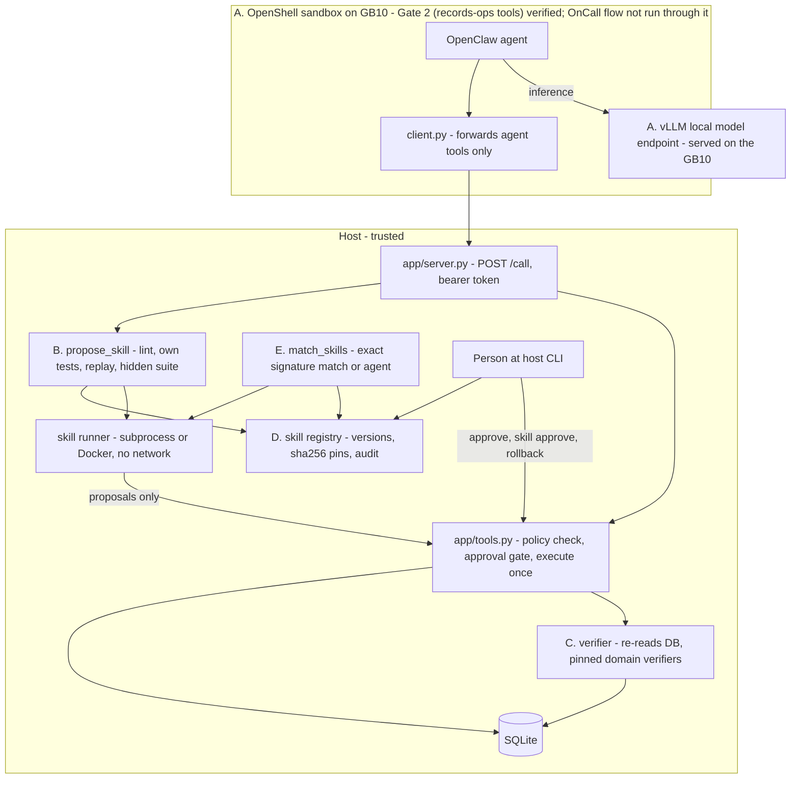

# Architecture and security

Scope: what the code in this repository does and where each part was checked. Everything marked "verified" was
verified on a Windows 11 x86_64 dev box without a GPU, with synthetic data and a MOCK agent, unless stated as GB10.
On the GB10 (2026-10-25) the following ran: vLLM serving, live OnCall synthesis and verification, approval and reuse
(subprocess runner), the NemoClaw/OpenShell/OpenClaw install, and the Gate 2 records-ops round trip through the sandbox.
The OnCall flow under OpenClaw (Gate 3) runs end to end and is NOT PASSED: the hidden suite refused the agent's candidate at human approval (8/9). Security model and known gaps:
[ARCHITECTURE.md](ARCHITECTURE.md).

## A. Local inference: GB10, NemoClaw, OpenShell, vLLM

| piece | design | state |
|---|---|---|
| Model serving | vLLM with an OpenAI-compatible API on the GB10; primary `nvidia/Qwen3.6-35B-A3B-NVFP4`, alternate Nemotron 3.5 Lightning (`data/models.json`) | run on the GB10 (2026-10-25): vLLM 0.21.0 serving Qwen3.6-35B-A3B-NVFP4 as `skillforge-qwen`; Nemotron attempted, 0 of 2 on OnCall ([CLAIMS.md](CLAIMS.md)). The committed recording contains no model output |
| Agent | OpenClaw inside a NemoClaw/OpenShell sandbox; SkillForge does not implement its own agent loop | installed on the GB10; Gate 2 (records-ops tools) GO 13/13; driving the OnCall flow (Gate 3) runs end to end, NOT PASSED (hidden suite 8/9 at approval) |
| Boundary | the sandbox holds only `SKILL.md`, `client.py`, `client.json`; the DB, verifier, hidden suite and approvals live on the host behind `python -m app serve` | service and client tested locally ([ARCHITECTURE.md §11](ARCHITECTURE.md)) |
| Egress policy | preset `adapters/openclaw/presets/host-tools.yaml`: host `host.openshell.internal`, POST `/call` only | applied and exercised on the GB10 for the Gate 2 records-ops round trip (no negative test recorded) |
| Model client | `adapters/llm.py`; `LLM_BASE_URL` unset or `mock` selects the MOCK client | MOCK when unset; the live OnCall runs used `--live` against the vLLM endpoint |
| Capability gate and failover | a model must pass a probe (endpoint, identity, tool call, schema, multi-step, latency) before it may write skills ([ARCHITECTURE.md](ARCHITECTURE.md)) | tested with mock and stubs |

Runbook: [GB10_RUNBOOK.md](GB10_RUNBOOK.md); setup notes: [GB10_RUNBOOK.md](GB10_RUNBOOK.md);
offline staging: [GB10_RUNBOOK.md](GB10_RUNBOOK.md).

## B. Program synthesis

A skill is a directory with `SKILL.md`, `scripts/helper.py` and `tests/test_helper.py`. The model writes
it after a verified solve. `propose_skill` (`app/skillforge.py`) then:

1. copies the draft to `candidates/<name>/vN` (over the service, it accepts file contents only, never a host path);
2. runs `lint`: an AST import and call allowlist (an early filter, not a proof);
3. runs the skill's own tests in the isolated runner;
4. replays the helper on the task's starting snapshot; its proposals must exactly equal the fixes a person approved
   and the verifier passed;
5. leaves the candidate `tested` or `failed_tests`. `hidden_check` later runs the hidden suite on the host.

In all recorded runs the author was a scripted MOCK flow, a human-written fixture
(`tests/fixtures/mock_authored_skill/`) or, for OnCall, a hand-written reference skill
(`experiments/oncall_infer/reference_skill/`). `experiments/oncall_infer` has a `--live` path that sends the prompt to
an OpenAI-compatible endpoint and counts calls; it fails loudly (exit 2, no run or registry written; audit in `<out stem>.failed.json`) instead of falling back, unless `--allow-fallback` is given. It is tested only against a stub server
(`test_live_path_counts_calls_and_tokens_against_a_stub_server`).

## C. Independent verification

| rule | where | test |
|---|---|---|
| Actions must match the policy: allowed action type, allowed field, value type and range, maximum change size | `_validate`, at propose time and again at execute time | `test_invalid_inputs_return_structured_errors` |
| Execution requires `status='approved'`, which only a human decision can set | `execute_action`, `decide_approval` | `test_execute_refused_without_approval`, `test_rejected_action_never_executes` |
| The agent tool set has no approve tool; approvers named `agent`, `system` or `policy` are rejected | `AGENT_TOOLS` | `test_agent_cannot_approve` |
| Proposals are deduplicated; each action executes once (`UNIQUE(action_id)`) | `propose_action`, `executions` | `test_duplicate_proposal_and_execution_prevented` |
| The verifier re-reads the database and re-runs the evidence comparison | `verify_action` | `test_verification_checks_real_state` |
| Domain verifiers are pinned and refuse contexts they were not validated for | `verifiers/pins.json`, `app/tools.py` | `test_tampered_or_unpinned_verifier_is_refused`, `test_newer_contract_revision_invalidates_the_verifier` (`tests/test_freight.py`) |
| A hidden suite the agent never sees must pass before promotion | `hidden_check` | `test_hidden_suite_catches_what_self_tests_and_replay_miss` |

**Tests are not a formal proof.** The replay, the skill's own tests and the hidden suite check finite cases. A
skill can pass all of them and still be wrong on inputs nobody wrote down. The run-time verifier is the second
line: every proposal a skill makes is verified after execution, and a failure is counted and returned as a hint.

## D. Secure promotion

- **Host-only approvals.** `approve`, `skill approve`, `skill reject`, `skill disable` and `skill rollback` are host
  CLI commands that take `--by <person>`. They are not agent tools; over the service they return `unknown_tool`.
  The browser UI is read-only (`app/ui_api.py`: loopback, Host check, one-time login, GET only).
- **Hashes.** A sha256 of the skill's file tree is taken at test time, checked at approval (`integrity_error` if the
  candidate changed) and checked on every run.
- **Versions.** `UNIQUE(name, version)`, one active version, rollback and disable.
- **Audit.** Every state change writes an audit row naming the actor.
- **No self-granted permissions.** The system writes `meta.json` with `allowed_operations: ["compute_proposals"]`;
  fields the agent supplies are ignored. A promoted skill only proposes.
- **Isolation.** `SKILL_RUNNER=docker`: `--network none --read-only --cap-drop ALL --security-opt no-new-privileges`,
  user 65534, 512 MB memory and swap, 1 CPU, 64 pids, the skill copy mounted read-only, killed on timeout. Checked
  locally on the dev box. The subprocess runner uses `python -I -B`, a scrubbed environment and a timeout; its
  rlimits are not applied on Windows.

Known gap: with the `--local` fallback package, the DB and tools run inside the sandbox and the agent has `exec`,
so the guarantees above hold only for paths through the tool interface ([ARCHITECTURE.md §11](ARCHITECTURE.md)).

## E. Deterministic reuse

- **Matcher.** `match_skills` compares a signature computed by trusted code (shape, kinds, sources, writable fields,
  invariants, plus the fields the skill touches). Exactly one approved, active skill must match exactly; otherwise
  the decision is `agent` with a reason. `run_skill` repeats the check (`uncertain_match`)
  ([ARCHITECTURE.md §12](ARCHITECTURE.md)).
- **Stale-contract invalidation** (experiment, `experiments/catalog/catalog.py`). When a pinned environment version
  changes (for example carrier contract `rev-2026-11`), dependent skills are marked `stale`, the registry entry is
  disabled so `run_skill` refuses it, and the same data is routed to a person until the skill is revalidated
  (`experiments/catalog/test_catalog.py`).
- **OnCall fingerprint refusal** (experiment, `experiments/oncall_infer/oncall.py`). For INC-3 the **core structural
  matcher says "exact"**, because the incident JSON has the same shape. The refusal comes from the experiment's
  incident fingerprint (exception type, component, failure category, top frames), which differs from the learned
  one. The fingerprint is bound to the approved skill's registry row (`skills.validation.incident_fingerprint`), and a
  missing fingerprint refuses (fail closed). Covered by `test_after_approval_inc2_reused_with_zero_model_calls_and_inc3_refused`.
  **Known core gap:** core reuse paths (`app/ops.py`, `app/skillforge.py`, `app/bench.py`, `experiments/router`) do
  not consult the fingerprint. A direct core `run_skill` on INC-3 is contained only because approval re-runs the
  hidden suite, whose lookalike cases force any approvable skill to propose nothing
  (`test_core_path_bypass_yields_no_proposal`). Closing the gap needs a core change; none was made.
- **No model on the reuse path.** OnCall reuse runs with a `NoModel` guard that counts any attempt and raises.

## F. Resource optimization

| item | state | evidence |
|---|---|---|
| Skip the model when an approved skill matches exactly | implemented | `app/bench.py` mode C; [ARCHITECTURE.md §13](ARCHITECTURE.md) (MOCK) |
| Count model calls and tokens; unknown stays null | implemented | `adapters/metrics.py`, `bench`; OnCall `model_calls` |
| Learning break-even | implemented as a formula; the model-call input is not yet computed (no measured per-task model-call comparison) | [ARCHITECTURE.md §14](ARCHITECTURE.md) |
| Faster skill variants | research only; the indexed freight variant is human-authored and was not promoted | [ARCHITECTURE.md](ARCHITECTURE.md) |
| TTFT probe for GB10 | run on the GB10 (frontier harness, 70 requests) | `experiments/gb10_bench/`, [GB10_RUNBOOK.md](GB10_RUNBOOK.md) |
| GPU-aware scheduling | **proposed only** | none |
| Model sleep/wake | **proposed only**; `experiments/router/power.py` is read-only detection and advice | [experiments/router/README.md](../experiments/router/README.md) |

GB10 numbers are TTFT, decode tok/s, memory, temperature and power for the served model and the OnCall reuse latency ([CLAIMS.md](CLAIMS.md)). No GPU, power or token saving versus an alternative is measured.

## Modules

| module | role |
|---|---|
| `app/tools.py` | `call(conn, name, args)`: the only agent entry point; errors return `{"ok": false, "error": {...}}` |
| `app/db.py` | SQLite connection (`APP_DB`), scenario loading, audit |
| `app/skillforge.py` | lint, runner, `propose_skill`, `hidden_check`, `approve_skill`, `match_skills`, `run_skill` |
| `app/server.py` | host tool service for the sandbox client |
| `app/ui_api.py` | read-only operator API for the browser |
| `app/bench.py` | three-mode benchmark and break-even |
| `adapters/` | model client and metrics, OpenClaw skill and OpenShell presets |
| `experiments/` | router, catalog, channel contract, Bootstrap Lite, OnCall, research; never imported by `app/` |

# Security model

Scope: what the code in this repository enforces, how it was checked, and where the known gaps are. Everything
marked "tested" was tested on a Windows 11 x86_64 dev box without a GPU, with synthetic data and a MOCK agent.
**Isolation on the GB10:** the timed live OnCall runs used the subprocess runner (Docker was permission-denied for
the GB10 user at first and the docker path fails closed); after a fix, the approved skill was re-verified on a copy under
the Docker runner ([CLAIMS.md](CLAIMS.md)). The OnCall runs did not run under NemoClaw/OpenShell
(installed on the GB10 on 2026-10-25, see Network exposure). The SkillForge `host-tools` egress policy was applied and
exercised on the GB10 for the Gate 2 records-ops round trip only. Live-model results:
[CLAIMS.md](CLAIMS.md). Design detail: [ARCHITECTURE.md](ARCHITECTURE.md)
sections C to E. Claims with their tests: [CLAIMS.md](CLAIMS.md).

### Trust model

| party | trusted for | not trusted for |
|---|---|---|
| Agent / model (OpenClaw in a sandbox, or the OnCall `--live` synthesis) | proposing fixes and drafting skill code | approving anything, grading its own work, choosing its permissions |
| Generated skill code | nothing until a person approves it; after approval, only to return proposals | writing state, network access, reading host files |
| Host CLI operator (a person) | approving actions and skills | being identified: the `--by` name is free text |
| Trusted host code (`app/`) | policy checks, execution, verification, hashing, audit | n/a (this is the trusted base) |

### Host-only approvals

- `approve`, `skill approve`, `skill reject`, `skill disable` and `skill rollback` are host CLI commands that take
  `--by <person>`. They are **not** agent tools: `decide_approval` is deliberately outside `AGENT_TOOLS`
  (`app/tools.py`), and over the host service they return `unknown_tool`.
- Approvers named `agent`, `system` or `policy` are rejected (`test_agent_cannot_approve`).
- Execution requires `status='approved'`; each action executes at most once (`UNIQUE(action_id)`); every state change
  writes an audit row naming the actor.
- The browser UI is read-only: `app/ui_api.py` binds to loopback, checks the `Host` header, uses a one-time login
  link and serves GET only. There is no approve button anywhere in the UI.

#### `approval.kind`: `simulated` or `host_cli`

OnCall run records (`experiments/oncall_infer`) carry `approval.kind`:

- `simulated`: the `--by` text marks the approver as an agent or a test (the committed recording
  `ui/public/demo/oncall-run.recorded.json` was approved by a coding agent with
  `--by "recorded-sim (agent, not a human)"` in a throwaway registry).
- `host_cli`: approved through the host CLI by text that is not marked as an agent or test.

The UI counts only `host_cli` as a person's decision and fails safe on anything else.
**Names are not identity-verified.** Anyone with a shell on the host can type any name. `host_cli` means "a
command was typed at the host", not "this named person approved". Identity binding (OS user, signed approvals) is not
implemented.

### Immutable hashes and versions

- A sha256 of the skill's file tree is taken when it is tested, checked again at approval (`integrity_error` if the
  candidate changed in between) and checked on every run (`test_tampered_approved_skill_refused`).
- Skill versions are `UNIQUE(name, version)` with one active version; `rollback` and `disable` exist; nothing
  overwrites an approved version.
- The system writes `meta.json` with `allowed_operations: ["compute_proposals"]`; fields the agent supplies are
  ignored. A promoted skill only proposes; its proposals go through policy, approval and verification again.
- Domain verifiers are pinned (`verifiers/pins.json`) and refuse contexts they were not validated for.

### Sandbox for generated code

`app/skillforge.py` `sandbox()` runs skill code in a throwaway copy with a scrubbed environment and a **15 s timeout**.

| runner | flags | checked |
|---|---|---|
| `SKILL_RUNNER=subprocess` (default) | `python -I -B`, scrubbed env, temp copy, timeout; POSIX rlimits | dev box. **rlimits are not applied on Windows** |
| `SKILL_RUNNER=docker` | `--network none --read-only --cap-drop ALL --security-opt no-new-privileges`, user 65534, 512 MB memory and swap, 1 CPU, 64 pids, skill copy mounted read-only, killed on timeout | dev box with Docker Desktop; on the GB10 only the re-verification of the approved skill on a copy ran under Docker, not the timed OnCall runs |

The static lint (AST import and call allowlist) is an early filter, not a security boundary. The runner is the
boundary.

#### Runner, lint and hidden-suite secrecy

- **GB10 runs used the subprocess runner** (`python -I -B`, scrubbed env, rlimits CPU 10 s / AS 1 GiB / FSIZE 1 MiB /
  NOFILE 64), as reported by the GB10 operator. Docker was permission-denied for the GB10 user; the docker path fails
  closed and was not weakened.
- **Finding (GB10-side audit, fixed in commit `1094d95`).** The lint could be bypassed by aliasing a banned builtin
  (`o = open`) or by `operator.attrgetter`. Under the subprocess runner a hostile skill could then read the hidden
  suite from disk. The lint now rejects aliased banned builtins, dunder names and `operator.attrgetter`/`methodcaller`.
- **Attempt 4 is not affected.** The passing live candidate (skill tree sha256
  `7fe0c025039b11b93617ba63955f3fe9da0ec55c7e7a0ed11bbae3982fa3aa0e`) imports only `json` and `typing`, uses no file,
  attribute or dunder access, passes the hardened lint, and its hash is unchanged, so its 9/9 hidden result is not
  contaminated.
- **Residual.** The lint is not a security boundary. Under the subprocess runner the hidden suite is readable by
  skill code that evades the lint; keeping it secret from a hostile skill needs the Docker runner.
  The approver identity (`--by`) is not authenticated. With the `--local` fallback package the DB and tools run inside the agent sandbox and the agent has `exec`,
so the guarantees above hold only for paths through the tool interface
([ARCHITECTURE.md §11](ARCHITECTURE.md)).

### Network exposure

- The host tool service refuses to bind `0.0.0.0`, `::` or an empty address (`app/server.py`); it is meant to be
  reached from the sandbox at `host.openshell.internal` with a bearer token that authorizes only the agent tool set.
- The operator console binds `127.0.0.1` (default port 8766).
- The OpenShell egress preset (`adapters/openclaw/presets/host-tools.yaml`) allows only POST `/call` to the host
  service. **Exercised on the GB10 (Gate 2 GO, 13/13) for the records-ops round trip only:** the OpenShell policy `host-tools` (dry-run reviewed, then applied) allows only `host.openshell.internal:8765`, rest/enforce, allowed IP `172.18.0.1/32`, POST `/call`, binary `/usr/bin/python3`; OCSF shows the agent call ALLOWED and `denied_action_count`=0. A negative test (another destination denied) is not recorded here.
- GB10 sandbox `skillforge` (operator report): the policies are `telegram_bot` (`api.telegram.org:443`, rest, enforce) and, since Gate 2, `host-tools`; inference goes to the local model as `https://inference.local`. OpenClaw's own telemetry (`telemetry.openclaw.ai:443`) was DENIED by the restricted tier. Verified in OpenShell OCSF logs for one Telegram <-> local model round trip and the Gate 2 host-tools round trip only; a non-allowlisted-sender check and a full egress review are **not done**. See [integrations/telegram/telegram_setup.md](../integrations/telegram/telegram_setup.md) and [integrations/telegram/GAPS.md](../integrations/telegram/GAPS.md).
- Gate 2 tool service (GB10 operator report, GB10 report sha256 `25a552fe863dcbcce74fb4c5b66c0d4243ec66e95a959d750af6c7f046b99885`): `python3 -m app serve --bind 172.18.0.1 --port 8765`, on the openshell docker bridge only (no 0.0.0.0), 401 without the agent token, `SKILL_RUNNER=docker`, on a scratch state so the approved OnCall registry was not touched. `decide_approval` is not in the agent's tool set (called from the sandbox: `unknown_tool`), so approval stays host-CLI only. The service now writes one access-log line per request (method, path, status, tool, ok; no body, no token), commit `2f8c6e7`. Not covered: the OnCall flow under OpenClaw (Gate 3: NOT PASSED: under the fixed bridge, the agent's one candidate passed every visible check and the hidden suite refused it at human approval, 8/9; no hidden information reached the agent; every `host-tools` call was ALLOWED and the only DENIED was OpenClaw telemetry; the hidden suite never left the host).
- **Exception to the no-0.0.0.0 rule.** NemoClaw's auth proxy listens on `0.0.0.0:11435` (token-protected, 401 without the token; hard-coded at `scripts/ollama-auth-proxy.mts:478`, not configurable). The rule binds SkillForge's own services (`app/server.py` still refuses `0.0.0.0`); this third-party listener conflicts with its intent. Proposed mitigation: UFW allow loopback and 172.18.0.0/16 to 11435, deny the rest. **Not applied; awaiting an operator decision.** Other new listeners are loopback/bridge only (127.0.0.1:8080 gateway, 127.0.0.1:18789 dashboard, 172.18.0.1:8080).
- The agent tool allowlist is fixed in code (`AGENT_TOOLS`). These isolation settings must not be weakened to make a
  check pass.

### Incident fingerprint and the core matcher gap

OnCall reuse (INC-2) and refusal (INC-3) depend on two layers:

1. The **core structural matcher** (`match_skills`) compares a signature of shape, kinds, sources, writable fields
   and invariants. INC-3 (disk full, a lookalike) has the same JSON shape as INC-1, so **core reports `exact`**.
   This is a known false-exact gap, pinned by `test_core_matcher_false_positive_on_lookalike_is_a_known_gap`.
2. The **OnCall incident fingerprint** (exception type, component, failure category, top frames) is stored on the
   approved skill's registry row (`skills.validation.incident_fingerprint`). The OnCall reuse path refuses when it
   differs, and **fails closed** when it is missing or tampered with (`test_missing_or_tampered_fingerprint_refuses_reuse`).

How the gap is contained: core reuse paths (`app/ops.py`, `app/skillforge.py`, `app/bench.py`, `experiments/router`)
do not consult the fingerprint. A direct core `run_skill` on INC-3 still proposes nothing, because approval re-runs
the hidden suite, whose lookalike cases force any approvable skill to return no proposal for INC-3
(`test_core_path_bypass_yields_no_proposal`). Even a wrong proposal would still need a person's approval and would be
re-verified. Closing the gap properly needs a core change (fingerprint in the core signature); none was made, because
the core is frozen except for blockers.

The reuse path also runs with a `NoModel` guard that counts any attempt to build a model client and raises, so
`model_calls: 0` is enforced, not just reported.

### Secrets

- No secrets are in this tree (grep-based scan over the tree and history; see [CLAIMS.md](CLAIMS.md)). A GitHub token that was exposed earlier is treated as compromised and must be revoked; none is stored in any tree or commit.
- `data/.agent_token`, `data/.operator_token`, `.env*` and runtime databases are gitignored.
- `deploy/gb10/sf-gb10.sh` reads the vLLM API key from a file into `LLM_API_KEY` and never prints it.
- `deploy/gb10/make_bundle.sh` refuses to build if the bundle contains this machine's hostname, git email or a
  Windows user-profile path (read at run time, not written into the script).

### Reporting a vulnerability

This is a hackathon prototype with no production deployment. Please do **not** open a public issue for a security
problem. Use GitHub's private vulnerability reporting ("Security" tab, "Report a vulnerability") on the repository;
it works only if it is enabled in the repository settings. Include the commit, the steps to reproduce and the impact. There is no bug bounty
and no response-time commitment.

## Reliability risks

Verified offline with `experiments/oncall_infer/test_reliability.py` (loopback stub only; no GB10/vLLM contact).

#### Fixed in experiments/ (reproduced, then fixed)
1. A strict `--live` run that failed during synthesis (endpoint healthy, model reply unusable) had already wiped the
   previous registry/state dir, although the CLI promises "nothing written". Now the old state is kept as `<state>.prev`
   and restored on failure.
2. `oncall.reuse` crashed with a traceback when core refused to run the approved skill (tampered artifact,
   `integrity_error`) and left the saved artifact saying "awaiting approval". It now records a refusal with core's reason.

#### Verified holding (no change needed)
INC-1/INC-2 fingerprints equal, INC-3 differs; untrusted or other-record evidence cannot move a fingerprint; non-human
approvers (agent/system/policy/blank/non-str) fail closed; agent tool dispatch has no approve path; tampered candidate,
tampered/extra file in the approved dir are rejected; approved copy is independent of the candidate; double approval and
double decision are invalid_state with provenance kept; repeated propose does not duplicate open actions; `--live`
(bad reply, 500, wrong model id, timeout, unreachable) raises LLMUnavailable, exit 2, no run or registry written (audit saved to `<out stem>.failed.json`); an overfit live
skill fails the hidden suite and is not staged; a runaway skill gets "timeout after Ns".

#### Remaining risks, ranked
1. **Approver identity is a typed string.** `approval.kind=host_cli` only means "not marked as an agent"; `--by alice`
   typed by an agent with host shell access is indistinguishable. `_human()` blocks only agent/system/policy.
   Mitigation is operational (agent has no host shell); not fixable in the registry.
2. **Core structural matcher accepts INC-3** (known gap). Protection depends on `oncall._decide` (fingerprint) and on the
   hidden suite run at approval. Any caller using core `match_skills` alone is not protected.
3. **Sandbox on the Windows dev box has no rlimits** (`preexec_fn` is POSIX only); only the wall-clock timeout applies.
   The GB10 timed runs used the subprocess runner with Linux rlimits (CPU 10 s, AS 1 GiB, FSIZE 1 MiB, NOFILE 64);
   `SKILL_RUNNER=docker` adds network isolation and keeps the hidden suite unreachable.
4. **`meta.json` is excluded from the artifact hash**, so `approved_by` in meta can be edited without detection. The
   authoritative provenance is the DB row and audit table, not meta.json.
5. **Live synthesis timeout is fixed at 300 s per call, 2 attempts** (up to ~10 min before a loud failure). Acceptable
   but slow to fail if the endpoint hangs after /models answers.
6. **`oncall.run()` default is `allow_fallback=True`** (the CLI passes False for `--live`). Library callers must pass
   `allow_fallback=False`; the output is always labelled RECORDED_SIMULATION when it falls back.
7. Running `pytest experiments/oncall_infer` (directory) also collects `reference_skill/tests` and errors on `import helper`;
   run the explicit test files.

